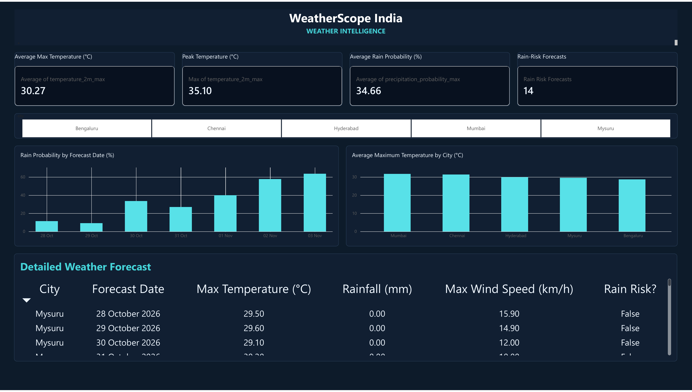

# WeatherScope India — API-to-Warehouse Automated Weather Data Pipeline

A Python ETL and analytics project that collects daily weather forecasts from the Open-Meteo REST API for five Indian cities, validates and transforms the JSON data with Pandas, stores timestamped snapshots in SQLite, and generates CSV/JSON reports for SQL analysis and Power BI visualization.

The project demonstrates an end-to-end data workflow: **API ingestion → transformation → data quality checks → SQLite warehouse → SQL analysis → reports → Power BI dashboard**.

**Live Streamlit Dashboard:** [Open WeatherScope India](https://weatherscope-india.streamlit.app/)

## Dashboard preview

**WeatherScope India — Weather Intelligence**



The dashboard contains four KPI cards, a city slicer, a rain-probability trend, a city temperature comparison, and a detailed forecast table.

- [Open the one-page dashboard PDF](reports/powerbi/weather-scope-india/WeatherScope_India_Dashboard.pdf)
- [Open the Power BI report file (.pbix)](reports/powerbi/weather-scope-india/WeatherScope_India_Dashboard.pbix)
- [Dashboard documentation and rebuild steps](reports/powerbi/weather-scope-india/README.md)
- [Power BI import CSV](reports/powerbi/weather-scope-india/data/WeatherScope_PowerBI_Import.csv)
- [Power BI theme JSON](reports/powerbi/weather-scope-india/WeatherScope_PowerBI_Theme.json)

> The PDF and image are static previews. The `.pbix` is the Power BI report artifact; the dashboard is not embedded as an interactive public report in this README. Public sharing depends on Power BI tenant policy.

## Business question

How do forecast maximum/minimum temperatures, precipitation, precipitation probability, and wind conditions differ across Bengaluru, Mysuru, Chennai, Hyderabad, and Mumbai over a seven-day forecast horizon?

This is a portfolio/learning project using forecast data. It is **not** an official warning system and does not represent verified observed weather.

## What the project does

1. **Extract:** calls the Open-Meteo Forecast API for each configured city and parses daily forecast fields from JSON.
2. **Transform:** converts dates and numeric fields, derives temperature range, creates a rain-risk flag, and records quality flags.
3. **Validate:** checks required fields, date validity, temperature consistency, precipitation probability bounds, and non-negative wind speed.
4. **Load:** appends forecast snapshots and run/quality metadata into SQLite.
5. **Report:** writes normalized forecast data, a city summary, rain-risk rows, run metadata, and a data-quality report.
6. **Analyse:** provides SQL queries for city comparisons, rain-risk dates, quality flags, and comparisons across forecast snapshots.
7. **Visualize:** includes the WeatherScope India Power BI report and its reproducible CSV/theme assets.

## Architecture

```text
Open-Meteo Forecast API
          |
          v
   src/extract.py
          |
          v
  src/transform.py  ---> derived fields + quality flags
          |
          v
    src/load.py
      /       \
     v         v
 SQLite DB   CSV / JSON reports
     |
     v
 sql/analysis_queries.sql

Power BI import CSV ---> WeatherScope India dashboard
```


## Tech stack

- **Language:** Python 3.9+
- **API:** REST / JSON, Open-Meteo
- **Data processing:** Pandas
- **HTTP:** Requests
- **Warehouse:** SQLite
- **Analytics:** SQL
- **Quality/testing:** custom validation rules and Python `unittest`
- **BI:** Microsoft Power BI
- **Artifacts:** CSV, JSON, PDF, PBIX, JSON theme

## Data source and attribution

- Provider: [Open-Meteo Forecast API](https://open-meteo.com/en/docs)
- Endpoint: `https://api.open-meteo.com/v1/forecast`
- Forecast timezone requested: `Asia/Kolkata`
- Cities and coordinates are configured in `config.py`.
- Forecast data can change between runs. The stored data is a snapshot of the forecast returned when the pipeline was executed.

Review [Open-Meteo's terms](https://open-meteo.com/en/features#terms) and attribution requirements before reuse, especially for public or commercial distribution. No API key is configured in this project.

## Project structure

```text
.
├── config.py
├── requirements.txt
├── src/
│   ├── extract.py          # API request and JSON parsing
│   ├── transform.py        # type conversion, derived fields, quality checks
│   ├── load.py             # SQLite loading and report exports
│   └── pipeline.py         # end-to-end orchestration
├── tests/
│   └── test_transform.py   # transformation/quality unit tests
├── sql/
│   └── analysis_queries.sql
├── docs/
│   ├── ARCHITECTURE.md
│   ├── DATA_DICTIONARY.md
│   └── PORTFOLIO_AND_INTERVIEW.md
├── data/
│   ├── raw/                # optional/raw data location
│   └── processed/
│       ├── weather_forecast.csv
│       └── weather_pipeline.db
└── reports/
    ├── city_forecast_summary.csv
    ├── rain_risk_days.csv
    ├── data_quality_report.json
    ├── latest_run.json
    └── powerbi/
        └── weather-scope-india/
            ├── WeatherScope_India_Dashboard.pbix
            ├── WeatherScope_India_Dashboard.pdf
            ├── WeatherScope_PowerBI_Theme.json
            ├── data-source.md
            ├── README.md
            ├── data/WeatherScope_PowerBI_Import.csv
            └── screenshots/
```

## Quick start

### macOS / Linux

```bash
python3 -m venv .venv
source .venv/bin/activate
python -m pip install --upgrade pip
python -m pip install -r requirements.txt
python -m src.pipeline
```

### Windows PowerShell

```powershell
py -m venv .venv
.\.venv\Scripts\Activate.ps1
python -m pip install --upgrade pip
python -m pip install -r requirements.txt
python -m src.pipeline
```

Internet access is required for the API call. The script uses request timeouts and reports city-level errors. If no city data can be retrieved, it stops rather than creating fabricated data.

## Run the tests

```bash
python -m unittest discover -s tests -v
```

Tests cover temperature range calculation, rain-risk flagging, invalid precipitation probability, and minimum temperature greater than maximum temperature.

## Data model and quality rules

Each row represents a **city × forecast date × fetch timestamp** snapshot. The SQLite database contains:

- `weather_forecast` — normalized forecast records and derived fields.
- `pipeline_runs` — metadata for each pipeline execution.
- `quality_checks` — quality summary for each execution.

Validation rules flag invalid/missing forecast dates, missing city names, missing maximum/minimum temperatures, missing precipitation totals, precipitation probabilities outside 0–100, minimum temperature above maximum temperature, and negative wind speeds.

Derived fields:
- `temperature_range_c = temperature_2m_max - temperature_2m_min`
- `is_rain_risk = precipitation_probability_max >= 50`
- `quality_flags` — semicolon-separated validation flags
- `needs_review` — whether any quality flag exists


## Generated outputs

| Output | Purpose |
|---|---|
| `data/processed/weather_forecast.csv` | Transformed forecast records from the latest run |
| `data/processed/weather_pipeline.db` | SQLite database containing forecast snapshots, run metadata, and quality checks |
| `reports/city_forecast_summary.csv` | Latest-snapshot summary by city |
| `reports/rain_risk_days.csv` | Latest-snapshot rows with precipitation probability ≥ 50% |
| `reports/data_quality_report.json` | Quality metrics and city-level errors |
| `reports/latest_run.json` | Last run status and row/city counts |
| `reports/powerbi/weather-scope-india/` | Power BI dashboard, PDF preview, theme, import data, and documentation |

## SQL analysis

Open `sql/analysis_queries.sql` to run examples that:
- compare average and peak maximum temperatures by city;
- summarize forecast precipitation;
- identify dates with precipitation probability at least 50%;
- inspect rows flagged for review; and
- compare forecast values across snapshots for the same city/date.

The queries target the SQLite table `weather_forecast`.

## Power BI dashboard: WeatherScope India

The dashboard is a reporting layer that complements the ETL pipeline. It uses a bundled 35-row CSV snapshot (five cities × seven forecast days) so the report can be reproduced without making a new API request.

Dashboard elements:
- KPI cards: average maximum temperature, peak temperature, average precipitation probability, and rain-risk forecast count.
- City slicer: Bengaluru, Chennai, Hyderabad, Mumbai, and Mysuru.
- Rain probability by forecast date.
- Average maximum temperature by city.
- Detailed forecast table.
- Dark navy and teal theme.

**Important:** the Power BI import CSV is a packaged snapshot, while `data/processed/weather_forecast.csv` is generated by running the pipeline. They are separate files; inspect their schemas and refresh timestamps before switching the dashboard to a different dataset. Follow the dashboard README for import/rebuild steps.

## Current sample run

The bundled run metadata records:
- 5 configured cities; 5 succeeded; 0 failed.
- 35 rows loaded.
- 0 rows needing review.
- Basic quality gate passed.
- Snapshot timestamp: `2026-10-28T11:23:17+00:00`.

These values describe the **saved sample run**, not a guarantee about future runs. Running the pipeline again will fetch a new forecast snapshot and may produce different values.

## Limitations and responsible interpretation

- Forecasts are predictions, not observations or guaranteed outcomes.
- Only five cities are included.
- A 50% precipitation-probability threshold is a project-defined analysis rule, not an official severe-weather warning.
- The starter project does not configure scheduled execution, deployed services, automated alerting, or production monitoring.
- A public Power BI link should only be added if it is enabled by the tenant administrator and approved for the data. A PDF/screenshot is provided as a static portfolio preview.


## License and reuse

No project-specific license file is currently included. Check the upstream data provider's terms and add an explicit repository license before inviting reuse or contributions.

---
Built as a portfolio project to demonstrate API ingestion, data transformation, validation, SQL, SQLite, automated tests, reporting, and Power BI.
